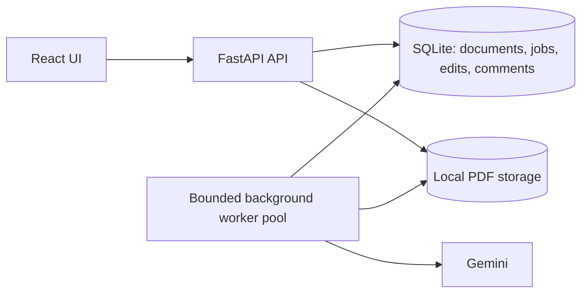
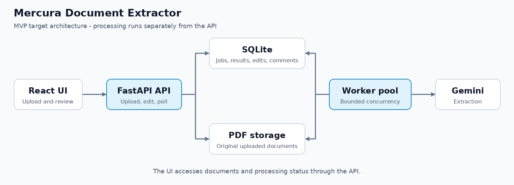
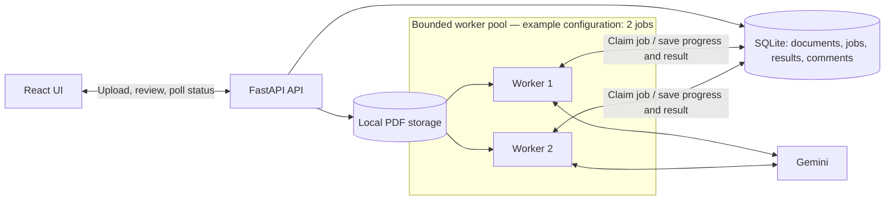

# Architecture

## Status

The MVP implements this architecture: a React document workspace, FastAPI API, SQLite persistence, local PDF storage, and a separate configurable worker process. See the [MVP plan](MVP_PLAN.md) for the feature scope, Git history for progress, and the [README](../README.md) for setup.

## Overview

The pool is shown as one component to keep the overview simple. It supports multiple concurrent processing loops, with one enabled by default.

[Open the diagram image](diagrams/architecture-overview.png) or its [SVG version](diagrams/architecture-overview.svg).

## Worker detail

One dedicated worker process runs one processing loop by default. Set `WORKER_CONCURRENCY=2` to use the two-loop configuration illustrated below. Concurrency is configurable from 1 to 8; these are logical workers inside the same process.

## Responsibilities and flow

1. The UI communicates only with the API. It uploads PDFs, polls for updates, and submits edits and comments.
2. The API validates and saves PDFs locally, creates durable queued jobs, and returns without waiting for extraction. Stored PDFs can later be downloaded through the API.
3. Available workers periodically check for eligible jobs, preferring the oldest. Each job must be claimed atomically so concurrent workers cannot claim it together. Workers wait briefly when the queue is empty.
4. A worker reads the PDF, prepares bounded chunks when necessary, calls Gemini, and persists results or errors. Blocking PDF preparation must not stall the other processing loops.
5. The UI shows queued, preparing, extracting, completed, or failed states. Chunk completion can provide measurable progress; a pending Gemini request does not provide a reliable extraction percentage.
6. Original AI extraction and user corrections are stored separately so retries or later processing cannot overwrite reviewed values. Comments are persisted with their document.

## Reliability and tradeoffs

- SQLite and local files keep the MVP easy to run on one machine. Queue operations use short transactions; database locks must not be held during Gemini calls.
- Jobs use 90-second leases, renewed every 30 seconds. An expired claim is eligible for recovery on the next queue scan, up to three automatic attempts. Tokens and lease checks reject stale workers. Retryable provider errors use delayed retries; terminal failures expose an explicit retry action. A retry repeats the document from the beginning, so provider calls may be repeated after interruption.
- Bound document concurrency, chunk sizes, and provider requests to control memory and API quota. Limit retries to transient failures and expose terminal errors clearly.
- Scanned sample PDFs require visual document understanding. Embedded-text extraction alone is insufficient. Chunking must respect provider page, byte, and context limits; conflicting extracted metadata needs explicit handling.
- Polling is sufficient for the MVP; updates arrive after a short delay. Authentication, shared object storage, a server database, and a dedicated queue are production extensions to evaluate when moving beyond a single trusted local deployment.

## Implementation map

- `server/main.py`: validated uploads, document APIs, optimistic edit revisions, comments, document deletion, and PDF serving.
- `server/db.py`: schema, persistence, atomic claims, leases, retries, and stale-owner protection. Database transactions never span provider calls.
- `server/processing.py`: PDF validation, page/byte-bounded chunks, Gemini Files API uploads, supported structured-output schema, strict local response validation, and conflict warnings. Remote files are deleted after each call on a best-effort basis.
- `server/worker.py`: separate asynchronous processing loops, off-thread PDF/database work, heartbeats, and document-scoped logs without raw provider errors or credentials.
- `app/src/api.ts`, `app/src/App.tsx`, and `app/src/components/`: typed HTTP contracts, bounded parallel uploads, status polling, review forms, per-document drafts, and comments. Vite proxies API requests to FastAPI.

## Practical limits and production extensions

The API accepts one PDF per request; the browser uploads up to two files concurrently. Files are written with generated names before document/job records commit. Failed uploads are cleaned up, but a process crash between filesystem and database operations can leave an orphaned file. Forced worker termination can also leave temporary chunks. Document deletion removes its database records in one transaction, then unlinks its stored PDF. If unlinking fails or the API crashes between those steps, an orphaned file can remain; the API logs cleanup failures. A production deployment should reconcile these periodically. Deleting a queued job prevents it being claimed. Deleting an active job invalidates its claim: a Gemini request already in flight may finish, but its result is discarded and no further chunks are submitted. Worker temporary chunks are cleaned up when processing exits.

Chunks are processed sequentially within a document. Every chunk is checked for metadata; the first nonempty value is selected deterministically and disagreements are flagged for human review. This favors full-document coverage over lowest latency/cost. Missing fields remain null. AI output still requires human verification; large scans with conflicting headers may need a more sophisticated reconciliation strategy.

The upload limit is checked before parsing when Content-Length is supplied and while copying the spooled upload. A public deployment needs an ingress body-size limit (including chunked requests), authentication, storage quotas, lifecycle policies, and hardened handling of untrusted files. Document listing is unpaginated for this local MVP; add indexed pagination and less frequent idle polling as workspace size grows. There is no user identity system: comments are workspace notes labelled “You.”

SQLite WAL and short transactions work for this local deployment; shared storage, a server database, durable chunk checkpoints, migrations, provider-wide quota management, and a dedicated queue should be evaluated before horizontal deployment.

## Verification

Automated tests cover upload validation, extraction with a fake provider, edits and stale-save conflicts, comments, downloads, restart persistence, retry limits, lease recovery, stale workers, concurrent jobs, Gemini response validation/cleanup, conflict warnings, document deletion (including during an in-flight extraction), and a 1,001-page synthetic PDF processed in bounded chunks. The large-file test validates orchestration, not real Gemini accuracy or latency on thousands of scanned pages.

Browser checks used the supplied scanned sample with the real Gemini service: upload, extraction, failure/retry, saved edits after reload, comments without losing a metadata draft, and mixed valid/invalid uploads. The desktop and default narrow layout were inspected. Additional browser interaction was declined during verification; per-document draft switching was reviewed in code but not completed as a browser check.

The per-document Delete button and confirmation/cancellation were checked in the browser. Deletion and stale-worker rejection were verified with isolated backend tests; existing workspace documents were retained during this check.
