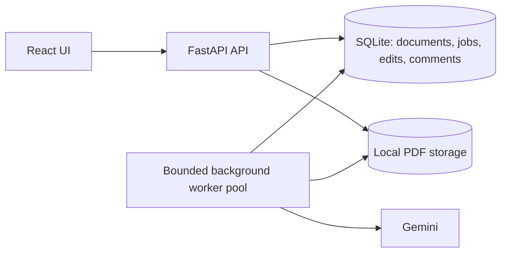
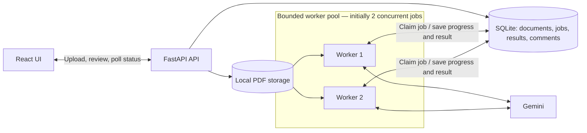

# Architecture

## Status

This is the agreed architectural direction for the MVP, not a description of a completed implementation. The worker pool, persistence, upload workflow, and review interface still need to be built.

The current baseline has a React health-check screen and a FastAPI endpoint that successfully extracts project metadata from one bundled PDF with Gemini. See the Git history for implementation progress and the [README](../README.md) for setup.

## Overview

The pool is shown as one component to keep the overview simple. It represents multiple concurrent processing loops.

[Open the diagram image](diagrams/architecture-overview.png) or its [SVG version](diagrams/architecture-overview.svg).

## Worker detail

Proposed starting configuration: one dedicated worker process with two concurrent processing loops. Pool size should be configurable. These are logical workers; they need not be separate operating-system processes.

## Responsibilities and flow

1. The UI communicates only with the API. It uploads PDFs, polls for updates, and submits edits and comments.
2. The API validates and saves PDFs locally, creates durable queued jobs, and returns without waiting for extraction. Stored PDFs can later be downloaded through the API.
3. Available workers periodically check for eligible jobs, preferring the oldest. Each job must be claimed atomically so concurrent workers cannot claim it together. Workers wait briefly when the queue is empty.
4. A worker reads the PDF, prepares bounded chunks when necessary, calls Gemini, and persists results or errors. Blocking PDF preparation must not stall the other processing loops.
5. The UI shows queued, preparing, extracting, completed, or failed states. Chunk completion can provide measurable progress; a pending Gemini request does not provide a reliable extraction percentage.
6. Original AI extraction and user corrections are stored separately so retries or later processing cannot overwrite reviewed values. Comments are persisted with their document.

## Reliability and tradeoffs

- SQLite and local files keep the MVP easy to run on one machine. Queue operations use short transactions; database locks must not be held during Gemini calls.
- Interrupted jobs need recoverable claims, such as expiring leases with heartbeats. Retry processing may run more than once, so saving results must tolerate duplicate attempts and reject stale workers. Exact recovery mechanics remain to be finalized.
- Bound document concurrency, chunk sizes, and provider requests to control memory and API quota. Limit retries to transient failures and expose terminal errors clearly.
- Scanned sample PDFs require visual document understanding. Embedded-text extraction alone is insufficient. Chunking must respect provider page, byte, and context limits; conflicting extracted metadata needs explicit handling.
- Polling is sufficient for the MVP; updates arrive after a short delay. Authentication, shared object storage, a server database, and a dedicated queue are production extensions to evaluate when moving beyond a single trusted local deployment.

Keep implementation details here as they are decided, and distinguish proposed behavior from behavior verified in code.
